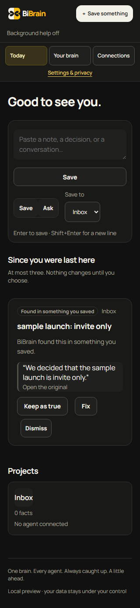
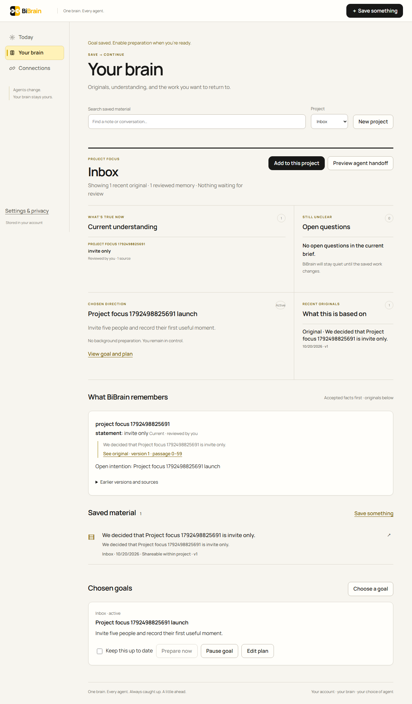
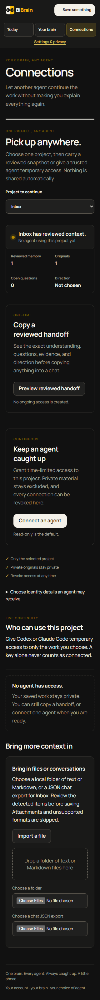
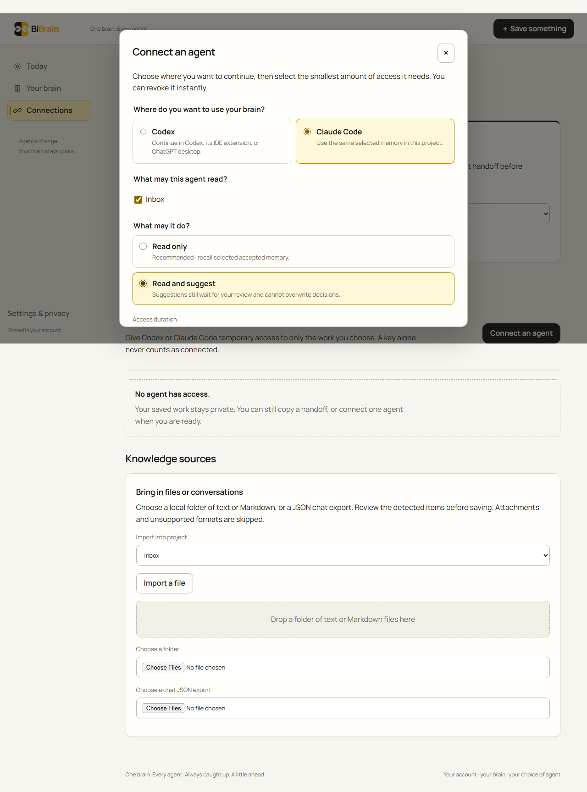

# BiBrain

**One brain. Every agent. Always caught up. A little ahead.**

BiBrain is a user-owned second-brain suite that keeps memory and continuity
outside any single AI agent. Save a thought, conversation, decision, or document
once; inspect the original; correct what BiBrain understands; and carry only the
right context into the agent you choose.

It is designed to feel like a living central unit for your work without asking
you to learn a “second brain” method. The primary experience is simply:

**Save → Continue → Stay ahead**


## What makes BiBrain different

- **One memory layer across agents.** Your context is not trapped in one chat or
  model provider.
- **Originals stay inspectable.** Generated claims require evidence or remain
  visibly labeled as hypotheses.
- **Corrections create history.** Human edits produce new versions; undo never
  overwrites a later edit.
- **Proactivity stays bounded.** BiBrain prepares work only for goals you chose,
  keeps quiet when nothing is useful, and never silently takes external action.
- **Local ownership is real.** The self-hosted edition works without an account,
  subscription, model key, or remote telemetry.
- **The interface reflects real state.** Its compact state card can be ready,
  organizing, waiting, refreshing, caught up, or quiet—never fake “AI thinking.”

## What works today

The merged application provides a complete single-owner local workflow:

1. Pair a browser to the local installation.
2. Save text, Markdown, notes, decisions, or supported conversation exports.
3. Keep immutable source versions in SQLite plus the portable Git-backed vault.
4. Follow one quiet first-session loop from saved original to reviewed meaning,
   search, and optional agent continuity; it disappears as the brain grows.
5. Review one clear memory suggested from ordinary language, or teach BiBrain
   the meaning of any exact passage. Nothing becomes current until you approve it.
6. Search the full retained text and reopen the original.
7. Copy an exact project handoff, or connect Codex or Claude Code through a
   guided, expiring, project-scoped permission flow.
8. Move from reviewed understanding into one guided proactive loop: choose a
   goal, request one source-linked review, then explicitly turn on quiet
   background preparation if you want it.
9. Open any project as a focused workspace for current understanding, open
   questions, chosen direction, recent originals, and an exact agent handoff.
10. Back up, restore, withdraw, delete, and revoke access with explicit safeguards.

The repository also contains the browser-first managed foundation: isolated
accounts, standards-based sign-in, guarded processing authority, recovery
controls, and a default-off Paddle subscription boundary. These paths have local
synthetic verification, but they are **not a public hosted service** and have not
processed a real payment.

## Release status

| Route                      | Current state                                                                                                                               |
| -------------------------- | ------------------------------------------------------------------------------------------------------------------------------------------- |
| Local / self-hosted        | Working single-owner application; no subscription required                                                                                  |
| Managed accounts           | Implemented foundation with local isolation and recovery evidence                                                                           |
| Connected model processing | Default off; live quality and cost gate still open                                                                                          |
| Paddle billing             | Default-off integration boundary; real Sandbox proof still open                                                                             |
| Agent connections          | Guided Codex/Claude setup, real-use verification and immediate revocation are implemented; native fresh-session certification is still open |
| Public cloud release       | Not deployed; hosting, legal, support, and human-pilot gates remain open                                                                    |

The merged foundation, guided connection and truthful first-session lifecycles
passed their recorded integration, broad Vitest, offline evaluation, browser and
container gates. The current branch replaces Today with one bar that saves or asks and a Brief of
at most three items; its browser regression passes 75/75 (see BUILD_STATE.md).
These are local release gates—not proof of a human usability pilot, live
model quality, native-agent compatibility, real billing, or target-host
operations. See
[BUILD_STATE.md](BUILD_STATE.md) for commands, exact scope, and known limits.

## Quick start

Requirements: Node.js **24.19 or later in the Node 24 LTS line** and npm 11+.

```powershell
npm ci
npm run db:migrate
npm run build
npm start
```

Open [http://127.0.0.1:4317](http://127.0.0.1:4317). Paste the private pairing
code from `data/owner-secret` into the first-use screen. A preview or custom
database folder has its own `owner-secret` beside that database; use the code
for the server open in your browser. The code is generated locally and is never
logged or exported.

No provider key is required. Without one, BiBrain keeps originals, search,
review, and labeled extractive previews available locally. Data is stored in
`data/brain.sqlite`; the API and durable worker run together under the local
supervisor.

For full setup, backup/restore, provider limits, and scoped agent configuration,
read [Run BiBrain locally](docs/LOCAL_RUN.md). For a private always-on server,
use [Self-hosting](docs/SELF_HOSTING.md) and `deploy/compose.yaml`.
Native Codex and Claude Code setup is in
[Connect a native agent](docs/NATIVE_CLIENT_SETUP.md); configuration readiness
is not a completed client certification.

## Product surfaces

- **Today** — one bar that saves or asks, a Brief of at most three things that
  changed (each with its quote and Keep, Fix, Dismiss and Undo), project cards, and
  a quiet state when nothing needs you.
- **Your brain** — a real-state Project Focus workspace plus sources, accepted
  understanding, open questions, history, corrections, search, goals, and
  evidence.
- **Connections** — one project-centered continuity workspace with exact manual
  handoffs, guided Codex/Claude setup, bounded live access, real-use status,
  immediate revocation, past-access history, and reviewed imports.
- **Settings & privacy** — appearance, background help, provider consent,
  spending controls, export, deletion, and managed plan state.

Technical terms such as models, queues, tokens, classifiers, and MCP stay out of
the primary flow. Every visible control either works or states why it is
unavailable.










## Architecture in one view

```text
Browser UI
   │
   ▼
Fastify application services ─── scoped stdio agent adapter
   │
   ├── SQLite operational state
   ├── Git-backed immutable source vault
   └── durable worker queue ─── optional bounded providers
```

Authorization is enforced in shared application services used by HTTP, agents,
exports, and workers. Model and webhook output are untrusted inputs: neither can
grant permission, increase a budget, change system instructions, or publish an
accepted fact without the relevant deterministic checks and human gate.

Read [Architecture](docs/ARCHITECTURE.md), [Data model](docs/DATA_MODEL.md), and
[Security and privacy](docs/SECURITY_PRIVACY.md) for the complete boundaries.

## Development and verification

```powershell
npm run typecheck
npm run lint
npm test
npm run build
npm run brain-eval
npm run test:e2e
```

Tests use isolated databases, deterministic clocks, and clearly synthetic
fixtures. A successful build or screenshot is not treated as feature proof.
Live-provider evaluation, native-client sessions, target-host recovery, and human
usability have separate gates.

## Documentation map

| Document                                           | Purpose                                                                     |
| -------------------------------------------------- | --------------------------------------------------------------------------- |
| [AGENTS.md](AGENTS.md)                             | Required instructions for coding agents                                     |
| [BUILD_STATE.md](BUILD_STATE.md)                   | Latest verified evidence and limits                                         |
| [NEXT_AGENT_HANDOFF.md](NEXT_AGENT_HANDOFF.md)     | Current continuation state and safe next steps                              |
| [Product](docs/PRODUCT.md)                         | Audience, promise, scope, and outcomes                                      |
| [UX](docs/UX.md)                                   | First-use, Today, review, and failure states                                |
| [Design system](docs/DESIGN_SYSTEM.md)             | Living visual language and accessibility                                    |
| [Approved interface brief](design.md)              | Official black/gold identity, responsive surfaces, states, and wiring rules |
| [Prototype handoff](design/BiBrain-HANDOFF_1.md)   | Delivered Claude prototype boundaries and the real-service wiring map       |
| [Architecture](docs/ARCHITECTURE.md)               | Runtime, storage, trust, and deployment shape                               |
| [API](docs/API.md)                                 | HTTP contracts and errors                                                   |
| [Agent integration](docs/AGENT_INTEGRATION.md)     | Scoped tools, grants, and client verification                               |
| [Native client setup](docs/NATIVE_CLIENT_SETUP.md) | Token-safe Codex/Claude setup and the required proof checklist              |
| [Managed operator guide](docs/MANAGED_RUN.md)      | Identity, activation, billing, and recovery gates                           |
| [Release](docs/RELEASE.md)                         | What can ship and what still blocks launch                                  |
| [Implementation plan](docs/IMPLEMENTATION_PLAN.md) | Dependency-ordered milestone checklist                                      |
| [Business](docs/BUSINESS.md)                       | Open-source and subscription decisions                                      |

## Open source and commercial route

BiBrain is being built to support both a useful self-hosted edition and a managed
subscription service that shares the same core trust model. The software license,
customer pricing, allowances, annual discount, legal terms, privacy disclosures,
and support commitments are still owner decisions. No permissive license is
granted merely by the presence of this repository.

Read [Business](docs/BUSINESS.md) and [Release](docs/RELEASE.md) before public
distribution or enabling live billing.

Official repository: [Rishflips/Bi-Brain](https://github.com/Rishflips/Bi-Brain)
