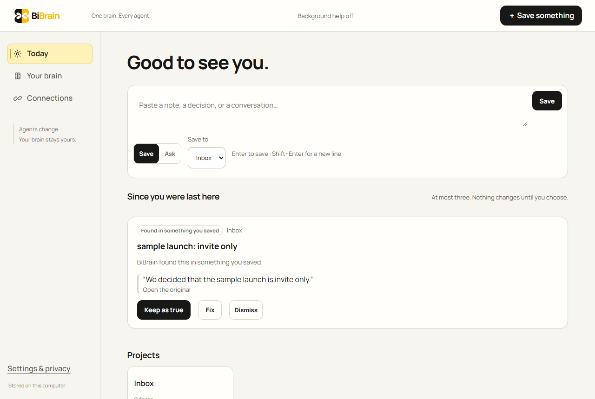
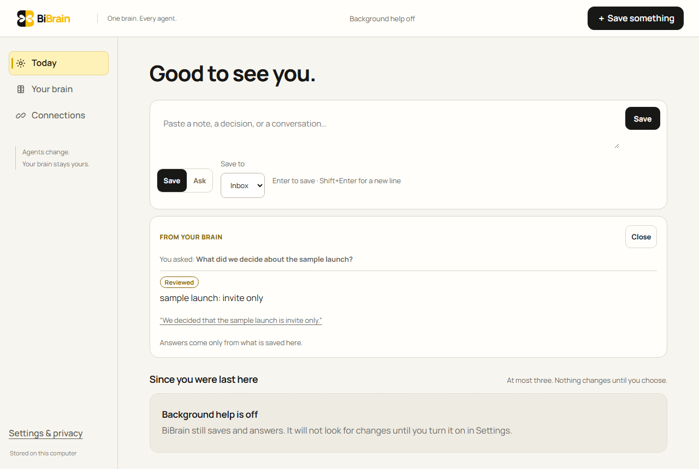

<h1 align="center">BiBrain</h1>

<p align="center">
  <strong>One brain. Every agent. Always caught up.</strong><br>
  A local-first second brain that your AI agents keep current, and that keeps your agents caught up.
</p>

<p align="center">
  <a href="https://github.com/Rishflips/Bi-Brain/actions/workflows/verify.yml"></a>
  <a href="LICENSE"></a>
  <a href="apps/mcp/LICENSE"></a>
  
</p>



You save a note once, or your coding agents write one when they finish work. BiBrain keeps the original and works out what changed. Each day it shows you at most three things worth a decision. Nothing becomes "true" until you keep it, and when nothing needs you, it stays quiet.

## Contents

- [What you get](#what-you-get)
- [Quick start](#quick-start)
- [Connect your agents](#connect-your-agents)
- [Optional sorting help](#optional-sorting-help)
- [Optional better search](#optional-better-search)
- [How you stay in control](#how-you-stay-in-control)
- [Status](#status)
- [How it is built](#how-it-is-built)
- [Development](#development)
- [Documentation](#documentation)
- [Contributing, security and licence](#contributing-security-and-licence)

## What you get

- **Today.** One bar that saves a note or answers a question from what you have kept, with the original quoted. Below it is a Brief of at most three things that changed. Each one shows its evidence, and you can Keep, Fix or Dismiss it (with Undo). Project cards each have a Watch switch.
- **Your brain.** Pick a project to see its facts that are true now (edit them as new versions), its open questions and its originals. Open any fact to see the exact passage it came from, highlighted, with its history. Search covers facts and originals across projects through the same ranked recall agents use.
- **Connections.** One tile each for Codex, Claude Code and Cursor:
  - **Add:** writes the agent's project file in one step, without the access key.
  - **Status:** shows "Connected" only after the agent's first real call.
  - **Revoke:** ends access immediately.
  - **Any other agent:** gets a copied handoff, or setup by hand.
- **Agent write-back.** Connected agents leave a short session note when they finish: decisions, open questions and the next step. Their decisions arrive as suggestions, never as accepted facts.
- **Sorting help (optional).** A small decision model, Clef, through Ollama or Cloudflare, looks at each new note:
  - it can suggest **"File in Northstar?"**;
  - it can rank a low-value card lower;
  - it can wake a review you already planned.

  It only suggests, and it stays within the daily limits you set.
- **Better search (optional).** Designed to find notes by meaning, including across languages such as English and Tamil, with Ollama on your computer or Cloudflare. Live quality is not yet measured (the owner-run `npm run proof:search` measures it). Off by default.
- **Watch.** Turn a project off and it goes quiet on Today, while everything stays in Your brain.



## Quick start

You need Node.js **24.19 or later on the Node 24 line** and npm 11 or later.

```bash
git clone https://github.com/Rishflips/Bi-Brain.git
cd Bi-Brain
npm ci
npx --no-install bibrain
```

BiBrain builds itself on first use, starts, and opens your browser already signed in through a one-time link. The link works once and expires after two minutes.
- **Open it again:** `npx --no-install bibrain open`.
- **After an update:** if you update with `git pull`, run `npm run build` once so the new version is served.

Run these commands from inside the BiBrain folder. `bibrain` is not published to npm; `--no-install` makes npx refuse to download anything with that name, so running it from the wrong folder fails safely.

To sign in by hand instead:
1. Run `npm run db:migrate`, `npm run build` and `npm start`.
2. Paste the pairing code from `data/owner-secret` into the first screen.

The code is generated on your computer and is never logged or exported.

No account, subscription or model key is needed. Your data stays in `data/brain.sqlite` plus a Git-backed vault of originals. Back it up with `npm run backup`.

## Connect your agents

1. Open **Connections**.
2. On the Codex, Claude Code or Cursor tile, choose **Add to …**.
3. Pick the project and the folder where you open that agent. BiBrain shows the exact files it will add (the server entry; for Claude Code and Codex a prompt hook that recalls from your brain on every prompt, which Codex runs after you trust it once; for Cursor a rule file), and never changes an existing file.
4. Open the agent in that folder and approve BiBrain once.

Agents read through one tool, `brain_recall`, which returns ranked, cited hits or says plainly that nothing is recorded.

The tile says **Connected** after the agent's first call. The access key stays in BiBrain's data folder on your computer and is never written into your project. Agents can read their project and suggest; they cannot accept their own suggestions.

Details: [Connect a native agent](docs/NATIVE_CLIENT_SETUP.md).

## Optional sorting help

1. Add these lines to a file named `.env` in the BiBrain folder. Keep the key only there; `.env` is git-ignored.

   ```bash
   # Ollama (simplest)
   BRAIN_SYSTEM1_PROVIDER=ollama
   OLLAMA_API_KEY=your-ollama-key

   # or Cloudflare Workers AI
   BRAIN_SYSTEM1_PROVIDER=cloudflare
   BRAIN_CLOUDFLARE_ACCOUNT_ID=your-32-character-account-id
   BRAIN_DECISION_API_KEY=your-workers-ai-token
   ```

2. Restart BiBrain.
3. In **Settings**, under "Background help & spending":
   1. Tick **"Turn on background help (sorting new notes and preparing reviews)"**.
   2. Set **"Daily cap (USD)"** and **"Per preparation cap (USD)"** above 0, for example 0.05 and 0.01.
   3. Tick **"Let BiBrain sort new notes with …"**.
   4. Press **"Save preferences"**.

The **Sorting help** card then reads "On". Until it does, it names exactly what is missing.

A few details:
- **Where the key lives:** only in BiBrain's background worker. It never reaches the browser.
- **Local Ollama:** works without a key. Set `BRAIN_SYSTEM1_ENDPOINT=http://127.0.0.1:11434/v1/systemone`. This has not yet been tested against a real local Ollama.
- **Live check:** to confirm your setup against the real service once, see [Providers](docs/PROVIDERS.md) (`npm run proof:sorting`).

## Optional better search

Better search finds a note by what it means, not only by the words you used. It is off by default and everything works without it.

1. Pick one and add its lines to `.env` (git-ignored). Ollama needs Ollama installed and `ollama pull bge-m3` run once; nothing leaves your computer.

   ```bash
   # On this computer (Ollama)
   BRAIN_EMBED_PROVIDER=ollama

   # or Cloudflare Workers AI (shares the two lines with sorting help)
   BRAIN_EMBED_PROVIDER=cloudflare
   BRAIN_CLOUDFLARE_ACCOUNT_ID=your-32-character-account-id
   BRAIN_DECISION_API_KEY=your-workers-ai-token
   ```

2. Restart BiBrain, then choose it in **Settings → Better search**. The Cloudflare choice says what is sent (notes, searches and the questions connected agents ask; never private notes), what it costs and that it counts against your daily limit.

Details and the live check: [Providers](docs/PROVIDERS.md) (`npm run proof:search`, owner-run).

## How you stay in control

- **Originals never change.** Corrections create new versions, and Undo never overwrites a later edit.
- **Nothing becomes fact without you.** Every suggestion carries its evidence. Agents and sorting help can only propose.
- **Access is scoped and revocable.** Each agent sees only the projects you pick, for a limited time.
- **Money is bounded.** Paid calls stay within your daily and per-note limits, are counted in whole micro-dollars, and are never sent twice.
- **Model output is untrusted.** It is validated against a fixed schema. It can never grant access, raise a limit or change instructions.
- **Quiet is a feature.** There is no endless feed. When nothing needs you, Today says so.

## Status

BiBrain is a working **single-owner local app**. This table is the honest state as of 2026-10-28. The verified details and the commands that ran are in [BUILD_STATE.md](BUILD_STATE.md).

| Area | State |
| --- | --- |
| Local app: Today, Your brain, Connections, Settings | Works end to end; verified on Windows with 1,930 Vitest tests and 107 Playwright browser tests |
| One-step agent connections with recall on every prompt | Verified in real Claude Code and Codex runs on Windows (`npm run proof:recall`, hook on and off); Cursor not yet run natively |
| Sorting help with Clef | One live check through Ollama Cloud validated 3 of 3 answers; thresholds not yet calibrated |
| Better search with embeddings | Built and gated against a fake embedder; a live run is owner-run (`npm run proof:search`) |
| Self-hosting on your own server | Supported: [Self-hosting](docs/SELF_HOSTING.md) and `deploy/compose.yaml` |
| Hosted edition and payments | Paused; the code is kept but not deployed |

Plan 6 (2026-10-28) removed the Paddle code and other dead code; the Dodo adapter and the money ledger stay paused, not deployed. What comes next is in the [reframe brief](docs/REFRAME_BRIEF.md).

## How it is built

```text
Browser (React)
   │
   ▼
Fastify API ─────────── agent connector (stdio, Apache-2.0)
   │
   ├── SQLite: operational state
   ├── Git vault: immutable originals
   └── durable worker queue ─── optional bounded providers (Clef, reasoning)
```

TypeScript throughout, React 19 with Vite, Fastify 5, Node's built-in SQLite, and Zod validation at every boundary. Authorization lives in shared application services used by HTTP, agents, export and the worker. Read [Architecture](docs/ARCHITECTURE.md), [Data model](docs/DATA_MODEL.md) and [Security and privacy](docs/SECURITY_PRIVACY.md).

## Development

```bash
npm run dev          # API, worker and Vite with live reload
npm run typecheck
npm run lint
npm test             # Vitest
npm run test:e2e     # Playwright, six projects
npm run brain-eval   # offline memory evaluation
npm run build
```

Tests use isolated databases, deterministic clocks and clearly synthetic fixtures. A passing build or a screenshot is never treated as proof that a feature works.

## Documentation

| Document | Covers |
| --- | --- |
| [Product](docs/PRODUCT.md) | Audience, promise, scope |
| [Reframe brief](docs/REFRAME_BRIEF.md) | The current direction and roadmap |
| [UX](docs/UX.md) | Screens, states and copy rules |
| [Design brief](docs/DESIGN_BRIEF.md) and [design system](docs/DESIGN_SYSTEM.md) | Visual identity and accessibility |
| [Architecture](docs/ARCHITECTURE.md), [Data model](docs/DATA_MODEL.md), [API](docs/API.md) | How the system fits together |
| [Agent integration](docs/AGENT_INTEGRATION.md) and [native setup](docs/NATIVE_CLIENT_SETUP.md) | Connecting agents |
| [Providers](docs/PROVIDERS.md) | Sorting help and model providers |
| [Run locally](docs/LOCAL_RUN.md) and [self-hosting](docs/SELF_HOSTING.md) | Running, backup and restore |
| [Testing](docs/TESTING.md) and [release](docs/RELEASE.md) | Verification and release gates |
| [History](docs/history/README.md) | Earlier build logs, audits and handoffs |
| [AGENTS.md](AGENTS.md) | Instructions for coding agents working on this repository |

## Contributing, security and licence

- **Contributing:** read [CONTRIBUTING.md](CONTRIBUTING.md). Issues and pull requests are welcome.
- **Security:** please report vulnerabilities privately, as described in [SECURITY.md](SECURITY.md).
- **Conduct:** see [CODE_OF_CONDUCT.md](CODE_OF_CONDUCT.md).
- **Licence:** BiBrain is licensed under the [GNU Affero General Public License v3.0](LICENSE) (`AGPL-3.0-only`). If you run a modified BiBrain as a network service, you must offer its source to that service's users. The agent connector (`apps/mcp` and `apps/cli`) is licensed under the [Apache License 2.0](apps/mcp/LICENSE), so other tools can embed it.
