# Design audit, November 2026

Branch `design/audit-2026-11`, from main at `2c5be68`. This audit walked BiBrain's core paths in a real browser (Chromium through Playwright) at three widths, measured the correctness floor, then judged the screens against a taste baseline derived from the product, not from trends.

Everything below was observed on a fresh throwaway brain: a test pairing code, Better search off, and a fake home folder. No owner data was read.

## How to repeat it

```bash
npm run build
node scripts/design-audit-walk.mjs data/audit-out
node scripts/design-audit-walk.mjs data/audit-dark --dark
```

The walk starts its own server and runs these steps:

1. Pair.
2. See the empty Today.
3. Save a decision.
4. Wait for its Brief card, then Fix, Cancel, Keep, and see the Undo toast.
5. Ask a question.
6. Add Codex to a temporary folder and write an agent note with that key.
7. Open Set up by hand.
8. Open Your brain and the agent note's drawer, then search.
9. Open Settings.

It captures 15 states at 1440×900, 820×1180 and 390×844, plus 720×450, which is what 200% browser zoom leaves on a 1440 screen. In `checks.json` it records:

- horizontal scroll and content past the viewport;
- targets under 24px, and under 40px on a phone;
- controls with no accessible name;
- text contrast against the nearest opaque background;
- text under 12px;
- layout shift between states;
- whether Tab stays inside an open dialog, and whether Escape returns focus to the control that opened it.

## 1. Taste baseline

**Product intent.**

- **Who:** one person who works with several AI coding agents across a handful of projects.
- **For what:** one durable, inspectable memory that the agents read before they work and suggest additions to afterwards. A glance-and-decide check-in, not a place to browse.
- **Character:** a quiet, editorial working tool. Closer to a well-made notebook or ledger than a dashboard. Premium through restraint: warm paper, black ink, gold only as a signal.

**What it should feel like at its best.**

- **One focal point per screen.** On Today it is the bar. In Your brain it is the project page. On Connections it is the one agent you can add next.
- **Every dark button means "this is the next step".** There is at most one per region.
- **Copy that helps you act.** Words that explain the system belong behind a disclosure or in Settings.
- **Calm and consistent.** One heading scale, one pair of radii, borders alone on surfaces, and no shadows except on floating layers.
- **Earned liveliness.** It comes from immediate, truthful feedback (receipt, Undo, focus moving to the right place), not from decoration.
- **Gradients, glass, emoji and decorative motion are not earned here.** The product's character is trust. The existing system already says so, and the audit agrees.

**Reading the existing documents as hypotheses.**

- `docs/DESIGN_SYSTEM.md` has the right character ("quiet, editorial, direct") and the right refusals. But it had no type scale, no named radius or focus tokens, and no rule for choice controls or loading. Each screen therefore invented its own, and that is where the drift came from.
- `docs/DESIGN_BRIEF.md` contradicts the system on several points:
  - It specifies Inter, while the app uses Manrope.
  - It specifies 20px and 28px radii.
  - It specifies 64px display headings for the app.
  - It calls for a "living field" with orbital paths, which `DESIGN_SYSTEM.md` forbids ("no orbit scenes").

  The implemented app follows the system, correctly. Both documents are revised below, citing the pages that triggered each change.
- Under the CSS: `style.css` (the green-era first layer) and `refinement.css` (the black-and-gold layer) both style the same elements. The token names no longer describe their values: `--green` is gold and `--green-deep` is ink. Specificity hacks such as `:root:root nav.yb-plist` exist to escape the first layer. The fix is proposed as L3 item 3.

## 2. What improved, ranked by impact

| # | Change | Level | Why |
| --- | --- | --- | --- |
| 1 | **Radios work again.** A global rule styled every non-checkbox input as a text field, so radios became 320×13 bars floating above their words (Connections → Add, Settings → Better search). Choice labels now use a hanging indent. | Floor | The permission choice ("Read and suggest" or "Read only") is a trust decision. Its controls were broken on every width. |
| 2 | **No layout jump on reload.** The page frame rendered before the header existed, then moved down 68px: a layout shift of 0.47 to 0.90 on every reload. While the session is read, only a status line renders now. | Floor | Measured shift fell to 0.006 on the same reload. |
| 3 | **Visible focus everywhere.** The ring was a 48% gold tint, about 1.3:1 against the canvas. It is now a solid `--focus` token: `#7a5c00` light, `#ffd247` dark. | Floor | Keyboard users could not see where they were. |
| 4 | **Today's bar has one primary action** (L2, below). | L2 | Two black "Save" controls sat side by side, and stacked Save-above-Save on phones. |
| 5 | **Dialogs keep focus inside.** Tab left Set up by hand and the source drawer after 5–6 presses. It now wraps. Focus return already worked. | Floor | Modal focus trap. |
| 6 | **Dark appearance is readable.** Eyebrows, the first-use step label, help text and Settings status lines measured 2.1 to 2.8:1. | Floor | Contrast. |
| 7 | **One heading scale.** Today's h1 was 40px at weight 750. Your brain, Connections and Settings used 58px at 620. Every workspace page now uses 40px at 650, and first use keeps its editorial 46–66px headline. | L1 | The same level of page looked like two products. |
| 8 | **Connections import is one drop panel** (L2, below). | L2 | Four unrelated-looking ways in, two of them raw browser pickers. |
| 9 | **Small text and phone targets.** Text under 12px raised to 12px. Phone targets raised to 44px: header action, Settings link, disclosures, section actions, file pickers and bar controls. | Floor | Legibility and touch. |
| 10 | **One pair of radii:** `--radius-control` 9px and `--radius-card` 14px. Today used 16px, Your brain 12px and Connections 14px. Weights of 750 and 800 came down to 650. | L1 | Drifting radii and weights read as unfinished. |
| 11 | **Connections emphasis.** Tiles stretched to the tallest tile, which left two near-empty white boxes. Every tile carried a full-width black button, even "Cursor: Not found on this computer". Tiles now size to their content. Only an agent that is found and not yet added gets the dark button. | L1 | No focal point. |
| 12 | **Copy that repeated itself is gone.** <ul><li>The rail slogan ("Agents change. Your brain stays yours.") and the footer slogan sat on the same screen as the header tagline: three slogans.</li><li>A Brief memory card said "Found in something you saved" as a tag and again as a sentence.</li><li>"Plan ahead (optional)" was followed by "Optional: …".</li><li>Settings showed job states as raw `succeeded` and "Worker is available.". They now read Done, Waiting or Failed, and "The background worker is ready."</li></ul> | L1 | Copy should help the person act, not narrate the system. |
| 13 | **Your brain metadata.** "Open the original" was 16px, semibold and gold inside a 13px metadata line, louder than the fact it belonged to. Links inside metadata now take the metadata's size. A section note ("Kept exactly as saved") sits beside its heading instead of floating mid-row. "Mark as reviewed" no longer touches its hint. | L1 | Content first, links second. |

Commits, one concern each:

- `d752922`: the walk script.
- `95464e6`: floor and L1.
- `1c80dfd`: L2-1.
- `2d5093d`: L2-2.
- `4742063`: drawer spacing.
- `7c4e1cb`: the dark-appearance fix.
- This report and the document revisions.

## 3. L2 evidence

Each L2 change is a single revertible commit. Its before and after screenshots are under `docs/design/audit-2026-11/`. They were captured by the walk at desktop (1440), tablet (820) and phone (390). Each "before" is the state immediately before that commit.

### L2-1 · Today: one primary action in the save and ask bar (`1c80dfd`)

| | Desktop | Tablet | Phone |
| --- | --- | --- | --- |
| Before | 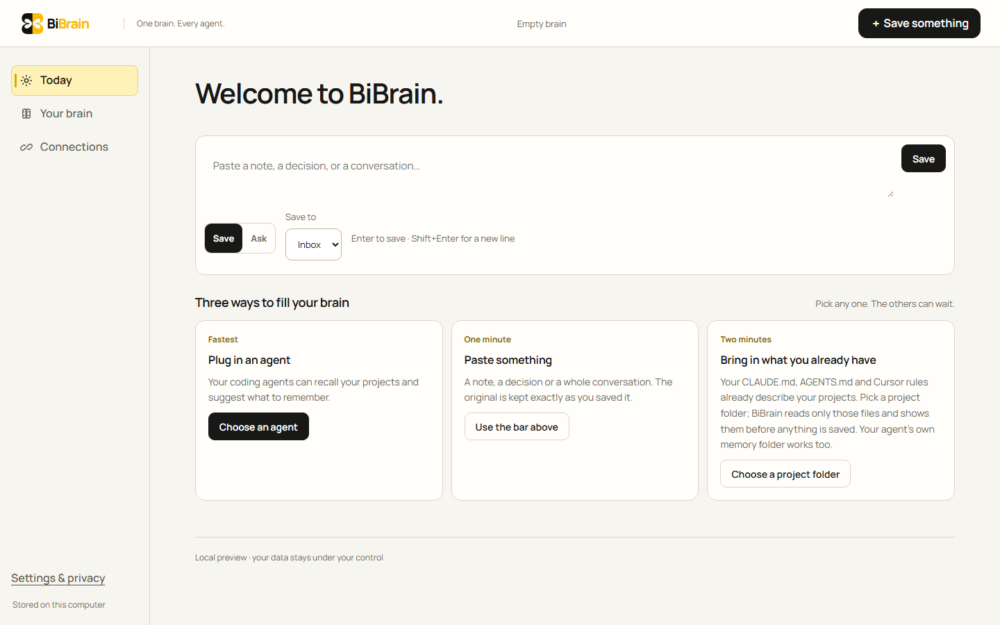 | 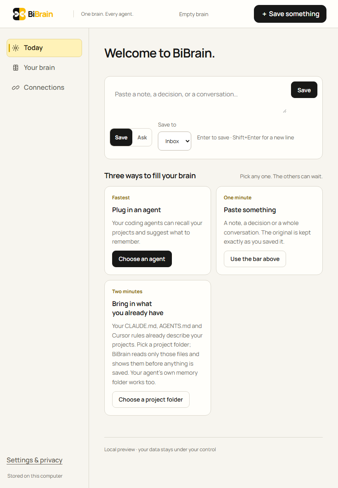 | 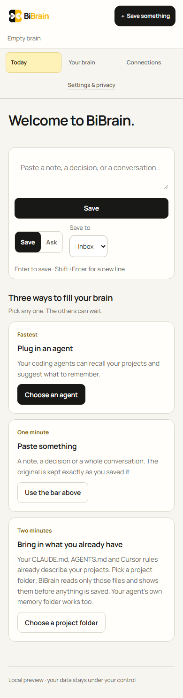 |
| After | 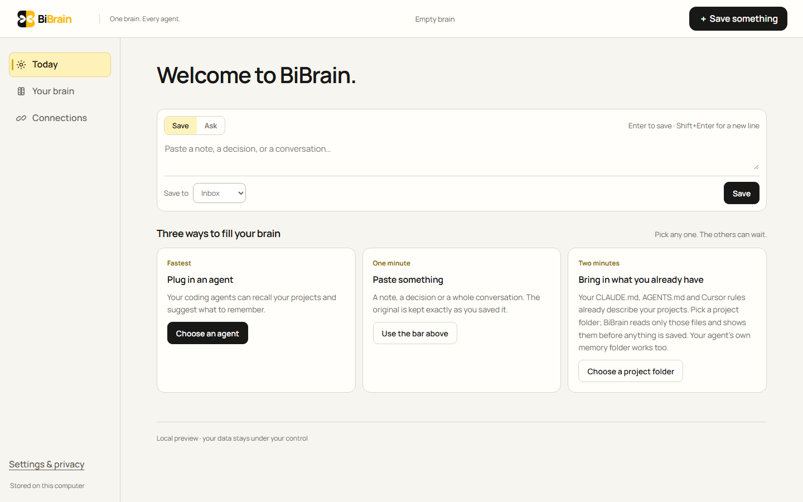 | 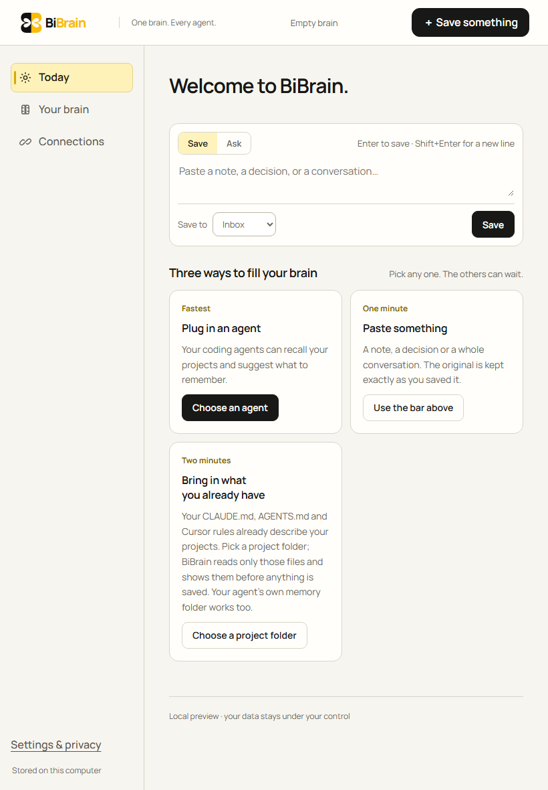 | 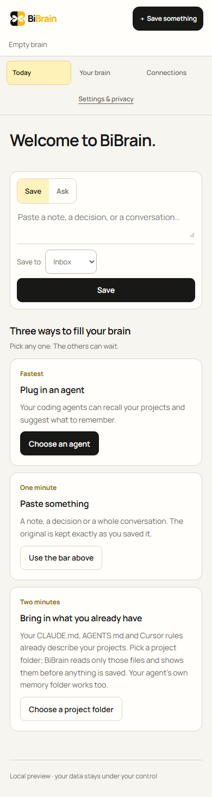 |

**Before.** The send button and the pressed "Save" mode were both solid black and both said Save. On a phone they stacked one above the other. The keyboard reached the send button before the mode switch it depended on.

**After.**

- The Save/Ask switch is a quiet choice above the box; the chosen mode gets a gold wash.
- The project picker and the single dark send button sit below the box, in reading order and Tab order.
- Typing draws one ring around the whole bar.

**Unchanged.** The labels and roles stay the same: "Save to your brain", "Save mode", "Ask mode", and Save/Ask.

### L2-2 · Connections: one drop panel for bringing context in (`2d5093d`)

| | Desktop | Tablet | Phone |
| --- | --- | --- | --- |
| Before | 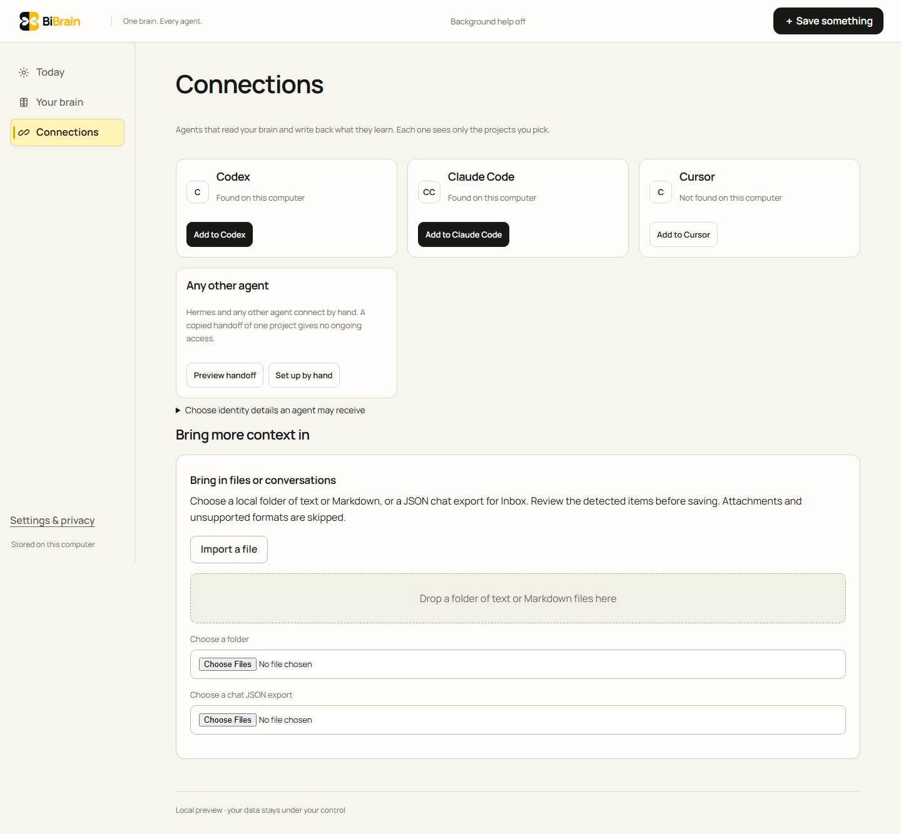 | 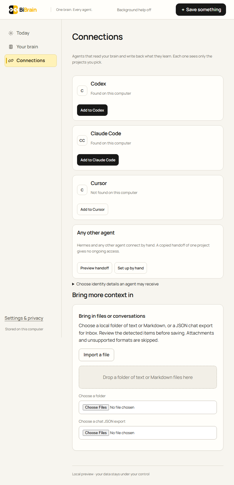 | 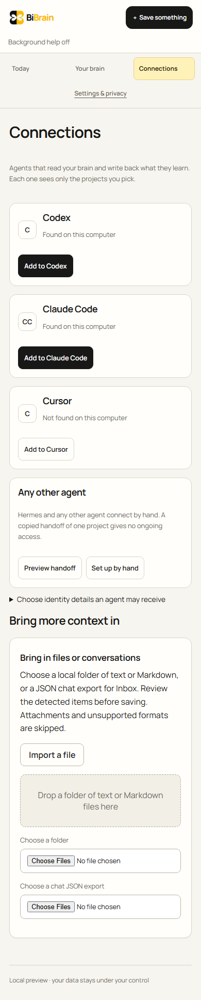 |
| After | 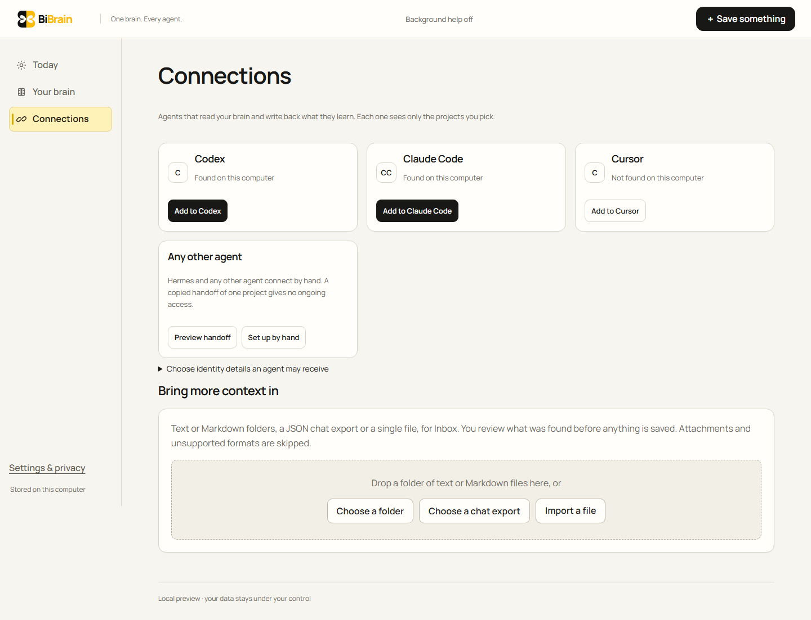 | 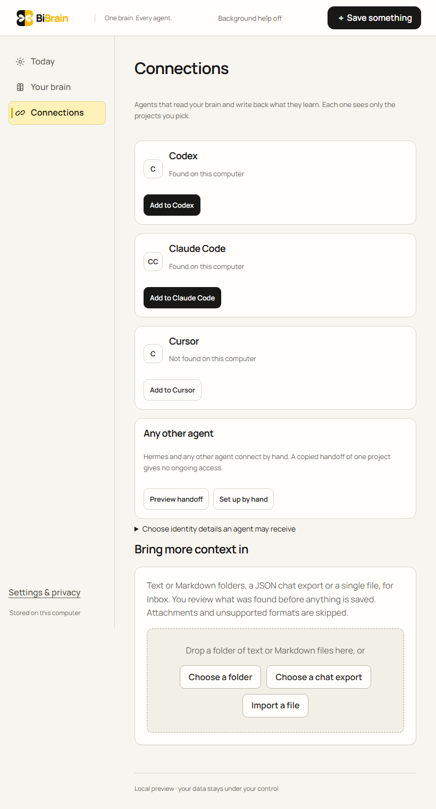 | 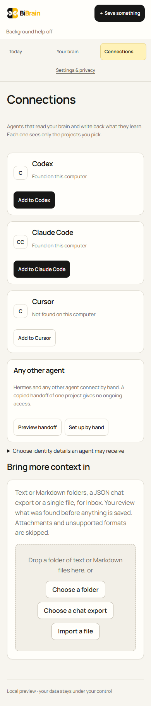 |

**Before.** The section stacked these, top to bottom:

- a second heading under "Bring more context in";
- an "Import a file" button;
- a drop area;
- two raw browser pickers reading "Choose Files / No file chosen".

**After.**

- One sentence says what can come in and that it is reviewed first.
- The drop area holds three equal choices: Choose a folder, Choose a chat export, and Import a file.

**Unchanged.**

- The inputs keep their accessible names, "Choose a folder" and "Choose a chat JSON export".
- The drop area keeps its `.dropzone` class.
- Picker and drop behaviour are the same.

### Floor fix shown for reference (part of `95464e6`, not L2)

| Before | After |
| --- | --- |
| 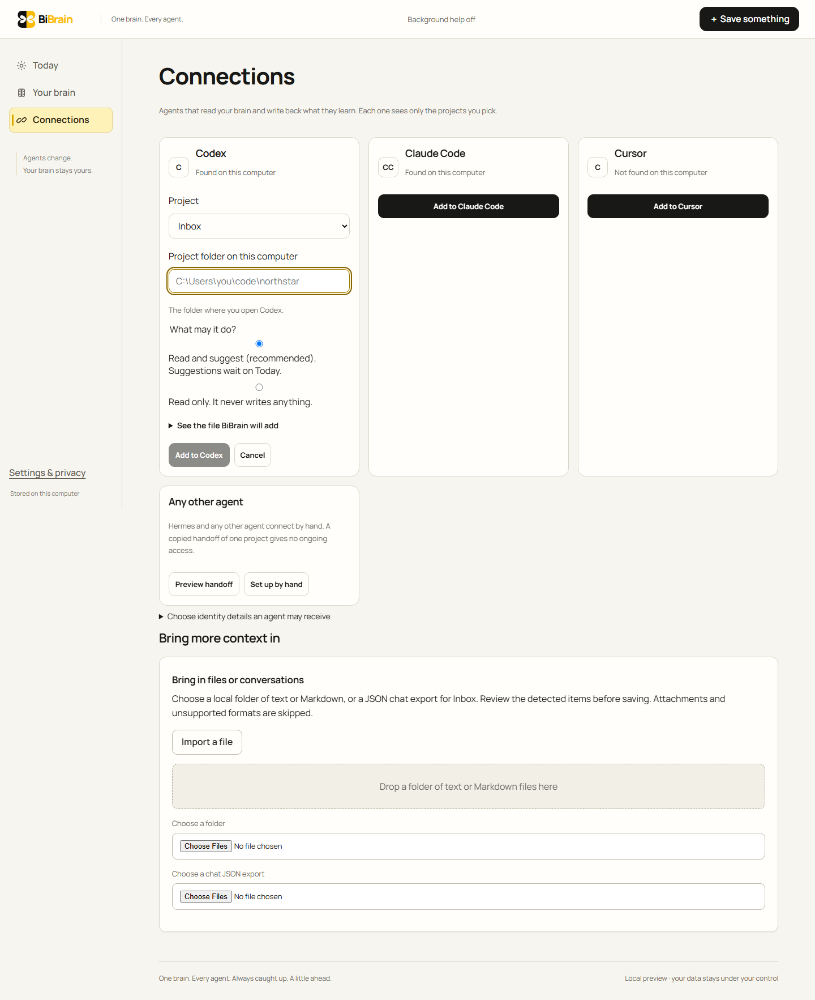 | 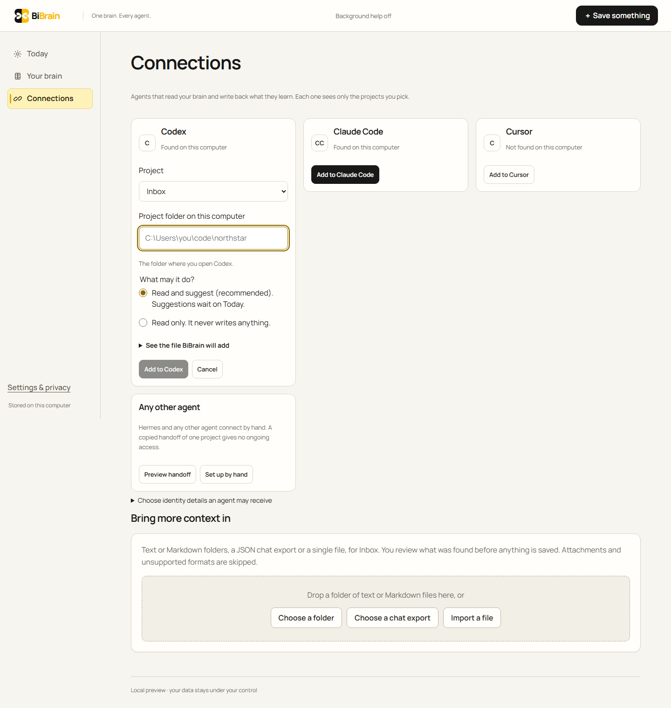 |

## 4. L3 proposals (not implemented)

Ranked by expected impact. None changes data, permissions or what an agent receives.

1. **Three save affordances on Today should be one.** The header's "+ Save something", the bar's Save button, and (before L2-1) the Save mode all opened capture.
   - **Proposal:** on Today, hide the header's Save something, because the bar is the capture. Keep it on Your brain and Connections, where there is no bar.
   - **Why L3:** this changes the global navigation model.
2. **The phone header spends two rows on chrome.** The status line ("Background help off") sits alone under the logo, and "Settings & privacy" is a fourth link wrapped under the three tabs.
   - **Proposal:** move the status into Today's own header. Make Settings an icon button in the masthead on phones.
   - **Why L3:** navigation model.
3. **One stylesheet foundation.** `style.css` (1,500 lines, green era) and `refinement.css` (1,100 lines) both style buttons, inputs, articles and navigation, and the second exists to override the first.
   - **Proposal:** fold them into one token file with honest names: `--ink`, `--signal`, `--muted`, `--line`, `--focus` and the two radii. Delete dead selectors such as `.today-hero`, `.mark` and the green-era dark gradients.
   - **Why L3:** this changes the design language's foundation. It touches every screen, so it needs its own visual-regression pass.
4. **Text that follows the person's text-size setting.** Type is set in px. Browser zoom works: the 720px check found no overflow or clipping on any state. But a larger default font size in browser or OS settings changes nothing.
   - **Proposal:** move the type scale to rem, together with item 3.
5. **Settings: one "Background help" story instead of three cards.** Better search, Sorting help, and Background help & spending each explain part of one choice: whether a service may read your notes, and within what limits. They point at each other ("Needs sorting help on first", "Needs a daily limit … below").
   - **Proposal:** one card with three steps:
     1. Allow background help.
     2. Set the limits.
     3. Choose what it may do (sort, recall help, better search).

     Each step is enabled only when the step before it is set.
   - **Why L3:** this merges features and changes the information architecture.
6. **The Connections waiting state is about 90 words of setup instructions** in a narrow column: "Open Codex in this folder. If Codex asks, trust the folder…".
   - **Proposal:** a three-item checklist (Open the agent here; Approve BiBrain; Ask anything) that ticks itself as BiBrain records the first call and the first push, with the long text behind "Details".
   - **Why L3:** a new interaction pattern, and copy owned by the Connections spec in `docs/UX.md`.

## 5. Correctness table

**Before** is main at `2c5be68`. **After** is this branch.

Overall counts, light appearance, across 15 states and 4 viewports:

| Finding | Before | After |
| --- | ---: | ---: |
| Text under 12px | 68 | 0 |
| Contrast below AA | 56 | 0 |
| Targets under 24px | 96 | 0 |
| Phone targets under 40px | 35 | 9 (inline text links, see below) |
| Dialog focus leaks | 2 | 0 |
| Layout shifts over 0.05 | 2 | 1 |

Dark appearance was measured on this branch, before its fix: 30 contrast findings, now 0.

| Page | Viewport | Issue | Severity | Status |
| --- | --- | --- | --- | --- |
| Connections → Add | all | Radios rendered as 320×13 text fields, separated from their labels | High | Fixed |
| Settings → Better search | all | Radios 1018×13; the "Not set up" hint split into a narrow column | High | Fixed |
| Settings → Background help | all | Two checkbox labels ran together on one line | Medium | Fixed |
| Every page | all | Focus ring was a 48% tint, about 1.3:1 against the canvas | High | Fixed |
| Every page, on reload | all | Layout shift 0.47 to 0.90: the header pushed the page frame down 68px | High | Fixed (0.006) |
| First use, Settings | all, dark | Eyebrow, step label, help and status text at 2.1 to 2.8:1 | High | Fixed |
| Connections → Set up by hand; Your brain → source drawer | desktop | Tab left the open dialog after 5–6 presses | Medium | Fixed (focus return already passed) |
| Rail ("Agents change.", "Stored on this computer") | desktop, tablet | 4.33:1 and 4.09:1, the second at 11px | Medium | Fixed (slogan removed; muted token, 12px) |
| First use, Settings, Brief tags, fact tags | all | Text at 10, 11 and 11.5px | Medium | Fixed (12px) |
| Header "Save something", Settings link, disclosures, "Choose a project folder" | phone | 38px, 22px, 38px and 26px tall | Medium | Fixed (44px) |
| Today bar | phone | Save/Ask switch 32px tall, project picker 36px | Medium | Fixed (44px) |
| Connections, after a reload with one connection | desktop | Residual layout shift of 0.08 to 0.12 as the page replaces Today | Low | Open |
| "Open it" and "Open the original" (inline links) | phone | 24px tall | Low | Accepted: inline-link exception (WCAG 2.5.8); they meet 24px |
| "Add to Codex" while the folder is empty | all | Disabled with no reason given; the hint above names the folder | Low | Open |
| Every page | 720×450 (200% zoom) | — | — | Pass: no horizontal scroll, clipping or unreachable control |
| Every page | 390 and 820 | — | — | Pass: no horizontal scroll or content past the viewport |
| Every page | all | Controls without an accessible name | — | Pass: none found |
| Every page | all | Type in px ignores the browser's default font-size setting | Medium | Open → L3 item 4 |
| First use | all | First Tab reaches the skip link | — | Pass |
| Brief, search, Settings | all | Loading, empty and error states | — | Pass: present, and covered by existing e2e tests (not re-tested by the walk) |

## 6. Design documents revised

- **`docs/DESIGN_SYSTEM.md`** gains an explicit type scale, radius tokens, a focus token, a one-dark-button rule, a choice-control rule, a loading rule and a dark-appearance rule. Each cites the page above that triggered it.
- **`docs/DESIGN_BRIEF.md`** gains a note at the top. Where it conflicts with `DESIGN_SYSTEM.md` (font, radii, display sizes, the living field), the system and the implemented interface win.

## 7. Limits

- The walk runs in desktop Chromium only. Safari and Firefox were not opened, and touch was not exercised on a real phone.
- 200% zoom was checked as the 720×450 viewport that results from it, not through the browser's zoom control.
- Screen-reader output was not listened to. Roles, names and focus were checked programmatically.
- Contrast is computed against the nearest opaque background. Text over images, or over semi-transparent layers, would need a manual look; none was found on these paths.
- Error and offline states were not forced by the walk. They rely on the existing e2e tests.
